# FPGA Cache Controller (VHDL)

This project focuses on the design and implementation of a cache controller on the Xilinx Spartan 3E FPGA using VHDL. The objective was to create a working memory hierarchy that connects a CPU transaction generator, SRAM cache memory, and an SDRAM memory model. The cache controller manages how data is accessed between these components by determining whether a request results in a cache hit or miss. It also handles reading and writing cached data, replacing cache blocks, and writing modified data back to main memory.

The design was implemented using Xilinx ISE and tested using simulation and ChipScope on the FPGA. The results were used to examine the controller's operation and measure the time required for different cache accesses.

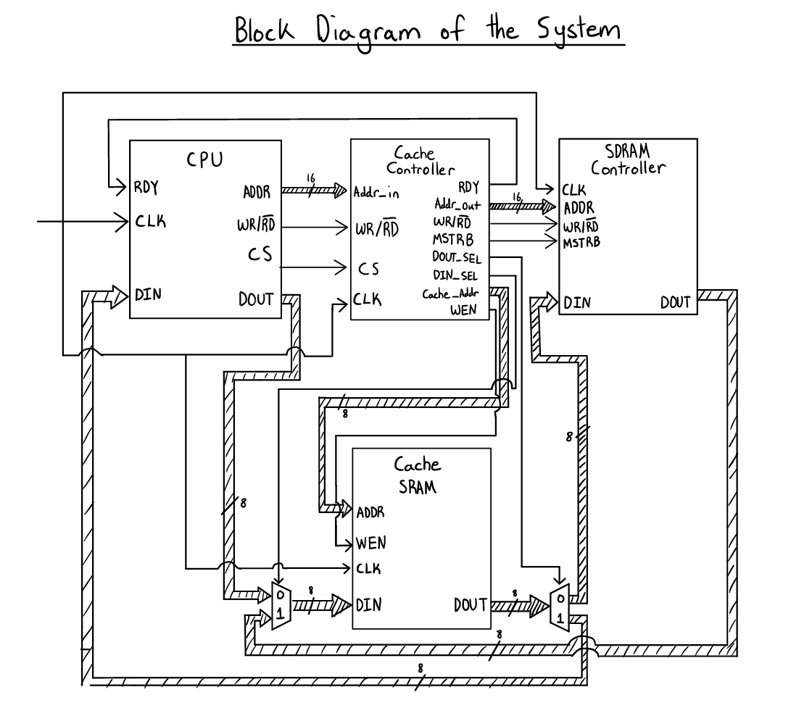

## Overview

A cache is used to reduce the time required for a processor to access data by keeping recently accessed blocks in faster memory. When the CPU requests data, the cache controller checks whether the requested block is already stored in the cache. If the block is present and valid, the controller performs the read or write using SRAM. If the block is not present, the controller must retrieve it from main memory before completing the CPU request.

The implemented design uses a direct mapped cache with eight lines, each containing 32 bytes. Each line also has a tag, valid bit, and dirty bit to track which memory block is stored and whether it has been modified. When a dirty block needs to be replaced, the controller writes its contents back to main memory before loading the new block.

The project includes eight predefined CPU transactions to test the different cache operations. These cover read hits, write hits, clean misses, and dirty misses. The controller state and memory signals were captured using ChipScope to verify the sequence of operations and measure their timing.

## System Specifications

| Component | Specification |
|---|---|
| Development board | Xilinx Spartan 3E FPGA |
| FPGA device | `XC3S500E`, `FG320`, speed grade `-5` |
| Language | VHDL |
| Development tools | Xilinx ISE, ISim, and ChipScope |
| Clock frequency | 50 MHz |
| Address width | 16 bits |
| Cache size | 256 bytes |
| Cache organization | 8 lines containing 32 bytes each |
| Cache implementation | Xilinx Block RAM |
| Main memory implementation | 65,536 byte behavioral memory model |
| Test inputs | 8 predefined CPU memory transactions |

The 16 bit CPU address is divided into three sections. The upper eight bits contain the tag, the next three bits select the cache index, and the lower five bits specify the offset inside the selected block.

| Address bits | Field | Purpose |
|---|---|---|
| `15:8` | Tag | Identifies the memory block stored in the selected cache line |
| `7:5` | Index | Selects one of the eight cache lines |
| `4:0` | Offset | Selects one of the 32 bytes in the cache block |

The SRAM is implemented using the Xilinx Block RAM IP core. The SDRAM controller in this project is a behavioral model of main memory rather than an interface to a physical SDRAM chip. It was used to model memory accesses and allow the operation of the cache controller to be tested on the FPGA.

## System Design

The memory hierarchy consists of five main VHDL modules that are connected through the top level `project1` module. Each module performs a separate function within the system.

### CPU Transaction Generator

The `CPU_gen.vhd` module simulates a CPU by generating predefined memory transactions containing an address, read or write instruction, chip select signal, and input data. The CPU generator was provided as part of the project and was used without modifications. It produces eight patterns that exercise the four required cache behavior cases.

### Cache Controller

The `cache_controller.vhd` module is responsible for managing memory requests and the transfer of data between SRAM and main memory. It separates each address into its tag, index, and offset, then compares the requested tag against the stored tag and valid bit. Depending on the result, it performs the requested operation directly in the cache or begins a block replacement.

The controller stores the tags, valid bits, and dirty bits for all eight cache lines. It also uses a block counter to transfer 32 bytes during refill and writeback operations. The `mem_strb` signal is used to control each memory transfer, while the FSM manages the order of the operations.

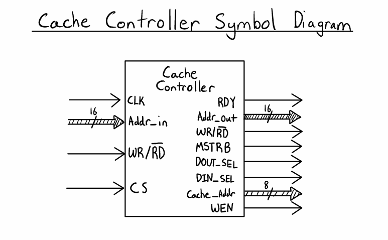

### SRAM Cache

The `cache.vhd` module connects the cache controller to the Xilinx Block RAM core. The Block RAM stores the cached data and is accessed using an address, data input, data output, and write enable signal. This module allows the cache memory to remain separate from the control logic.

### SDRAM Memory Model

The `sdram_controller.vhd` module simulates main memory using an array containing 65,536 bytes. It receives the address, data, read or write control, and memory strobe signals from the cache controller. It performs the corresponding memory operation when the controller asserts the strobe.

### Top Level Integration

The `project1.vhd` module connects the CPU generator, cache, SDRAM model, and ChipScope ICON and ILA cores. It also uses the cache controller's ready signal to trigger the next CPU transaction automatically. This removes the need to manually trigger each test pattern using switches or external controls.

## Cache Controller State Machine

The controller uses a finite state machine with eight states. Each state is responsible for a specific operation, making it possible to follow the behavior of the controller through the simulation waveforms.

| State | Binary value | Function |
|---|---|---|
| `IDLE` | `000` | Waits for a CPU memory request |
| `COMPARE` | `001` | Compares the requested tag and valid bit to determine a hit or miss |
| `HIT_RD` | `010` | Reads the requested data from the cache |
| `HIT_WR` | `011` | Writes data into the cache and sets the dirty bit |
| `MISS_CLEAN` | `100` | Prepares the cache for a refill when writeback is not required |
| `MISS_DIRTY` | `101` | Prepares to write a modified block back to main memory |
| `REFILL` | `110` | Loads 32 bytes from main memory into the cache |
| `WRITEBACK` | `111` | Transfers 32 modified bytes from the cache to main memory |

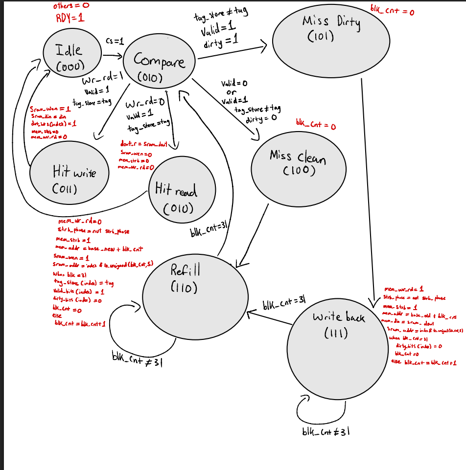

### Case 1: Read Hit

A read hit occurs when the requested tag matches the tag stored in the selected cache line and its valid bit is set. The controller moves from `IDLE` to `COMPARE`, then to `HIT_RD`. The requested data is read from SRAM and returned to the CPU without accessing main memory. Once the request is completed, the controller returns to `IDLE`.

### Case 2: Write Hit

A write hit occurs when the requested block is already stored in the cache. After the tag comparison, the controller enters `HIT_WR` and writes the CPU data into the selected SRAM location. The dirty bit is then set to indicate that the data in the cache has been modified and no longer matches main memory.

### Case 3: Clean Miss

A clean miss occurs when the requested block is not present and the selected cache line does not contain modified data that needs to be saved. The controller enters `MISS_CLEAN` followed by `REFILL`, where it transfers the required 32 byte block from main memory into SRAM. After the transfer, the stored tag and valid bit are updated. The controller then returns to `COMPARE` and completes the original read or write request.

### Case 4: Dirty Miss

A dirty miss occurs when the requested block is not present and the cache line that will be replaced has its dirty bit set. The controller enters `MISS_DIRTY` followed by `WRITEBACK`, where the 32 bytes from the old cache block are written back to main memory. After the writeback completes, the controller enters `REFILL` to load the new block. It then updates the tag and valid bit before completing the CPU request.

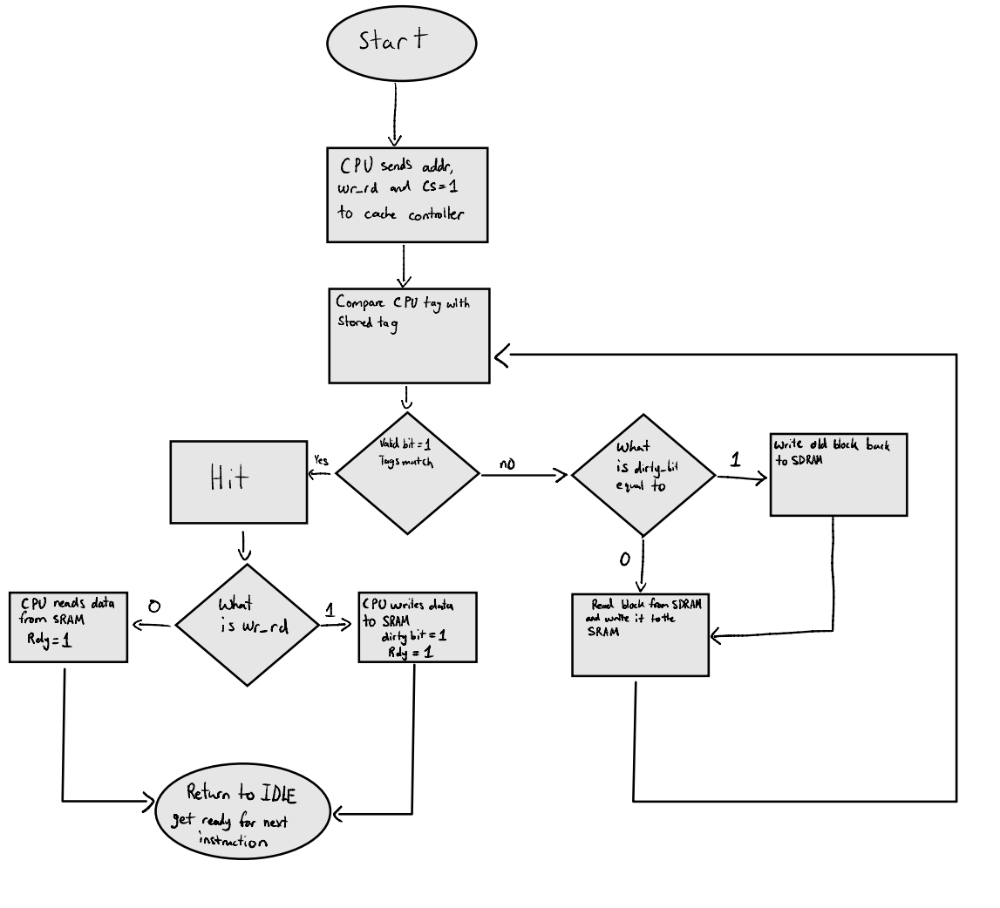

## Verification and Results

The controller was tested using the predefined CPU transactions. The functional waveforms were used to confirm the transitions between the states, the behavior of the valid and dirty bits, and the transfer of data between the cache and main memory.

### Clean Miss and Refill

The following waveform shows a memory access that results in a clean miss. The controller moves into the refill state and transfers the requested block from main memory into SRAM before completing the operation.

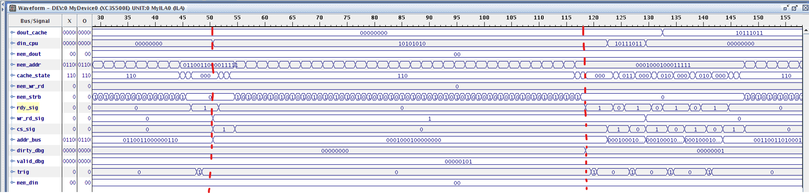

### Read and Write Hits

The following waveform shows requests to memory locations within a block that is already stored in the cache. The controller performs the corresponding read and write operations without requiring another block refill.

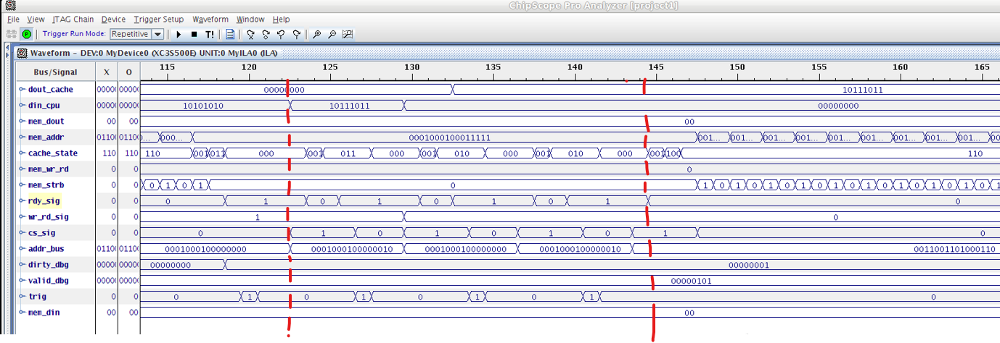

### Dirty Miss and Writeback

The following waveforms show a request that replaces a modified cache line. The controller first writes the existing block back to main memory, then refills the cache with the newly requested block. This demonstrates the additional operations required when the dirty bit is set.

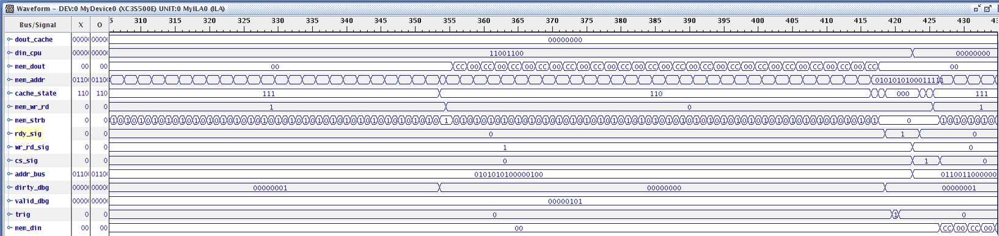

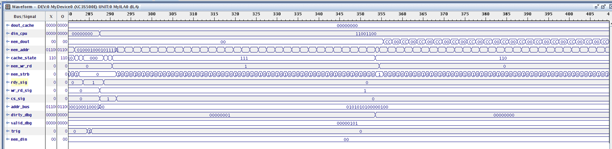

### Cache Performance Measurements

ChipScope was also used to measure the timing of the different cache operations. Since the FPGA clock operates at 50 MHz, each clock cycle represents 20 ns. The number of cycles observed in each waveform was used to calculate the following values.

| Cache operation | Measured time |
|---|---:|
| Hit or miss determination | 20 ns |
| Data access | 20 ns |
| Block replacement | 1,280 ns |
| Read or write hit | 80 ns |
| Clean miss penalty | 1,360 ns |
| Dirty miss penalty | 2,680 ns |

**Hit time**

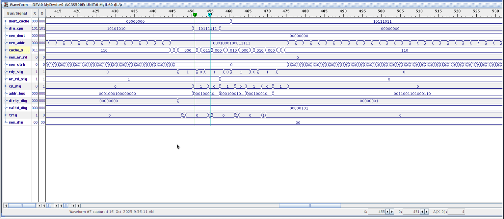

**Clean miss penalty**

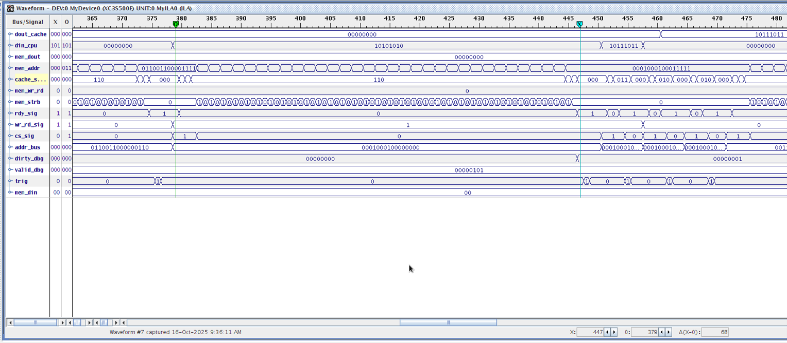

**Dirty miss penalty**

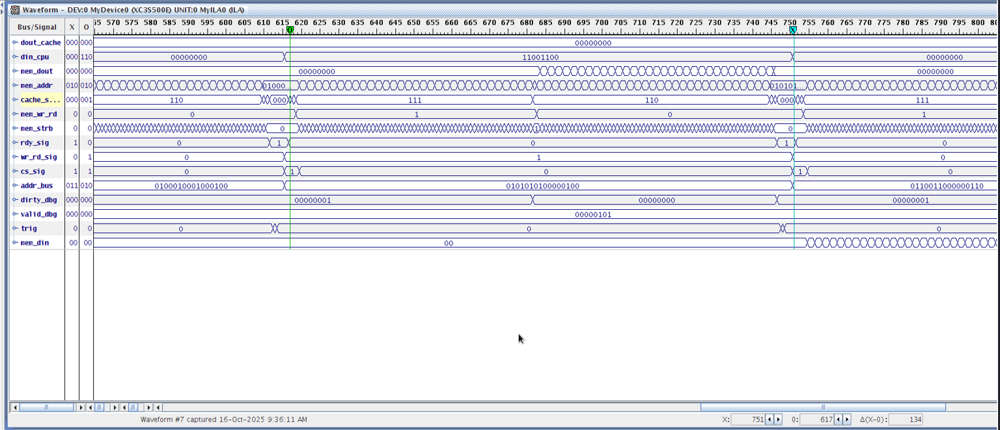

The results show that a cache hit requires less time because the requested data is already stored in SRAM. A clean miss takes longer because a new block must be transferred from main memory, while a dirty miss requires both a writeback and a refill. These measurements were obtained from the tested project configuration and are not intended to represent the performance of a physical SDRAM interface.

## Project Files

The original Xilinx ISE project structure was preserved to keep the source files and IP references consistent.

| File or folder | Description |
|---|---|
| `Project1_Cache_Controller.xise` | Original Xilinx ISE project |
| `project1.vhd` | Main module that connects the CPU, cache, memory model, and ChipScope |
| `cache_controller.vhd` | Cache control logic and finite state machine |
| `cache.vhd` | SRAM cache wrapper |
| `sdram_controller.vhd` | Behavioral main memory model |
| `CPU_gen.vhd` | Provided CPU transaction generator |
| `tb_project1.vhd` | Simulation testbench |
| `project1.ucf` | FPGA pin constraints |
| `project1.prj` and `tb_project1.prj` | Source lists for the project and simulation |
| `test.wcfg` | Saved waveform configuration |
| `ipcore_dir/` | Xilinx Block RAM and ChipScope IP files |
| `docs/images/` | Project diagrams and simulation screenshots |
| `docs/BUILD_NOTES.md` | Additional information about the original ISE project and IP files |
| `.gitignore` | Excludes generated files from version control |

## Opening the Project

The design was developed using Xilinx ISE for the Spartan 3E FPGA. To open and build it, the original Xilinx toolchain and the appropriate FPGA device support are required.

1. Download or clone the repository and open `Project1_Cache_Controller.xise` in Xilinx ISE Project Navigator.
2. Confirm that the selected FPGA device is `XC3S500E`, package `FG320`, with speed grade `-5`.
3. Select `project1.vhd` as the top module for implementation. The file `tb_project1.vhd` can be selected when running the simulation.
4. Run the synthesis, implementation, and programming file generation steps to build the design for the FPGA.
5. Use ISim for functional simulation or ChipScope for monitoring the signals when running on the board.

The required source files, hardware constraints, and IP configuration are included in the repository. The project has not been rebuilt using a newer toolchain, so a working installation of the original Xilinx tools may be required. Additional information is provided in [Build Notes](docs/BUILD_NOTES.md).

## Conclusion

The project demonstrates the design of a cache controller that manages data transfers between a CPU, SRAM cache, and main memory model. The controller was able to handle read and write hits, clean misses, and dirty misses using a finite state machine. The test results showed the expected state transitions and updates to the valid and dirty bits, while the ChipScope timing measurements showed the additional time required for block replacement and writeback operations.

Overall, the implementation demonstrates how the main functions of a memory hierarchy can be combined and tested using VHDL and FPGA development tools.
